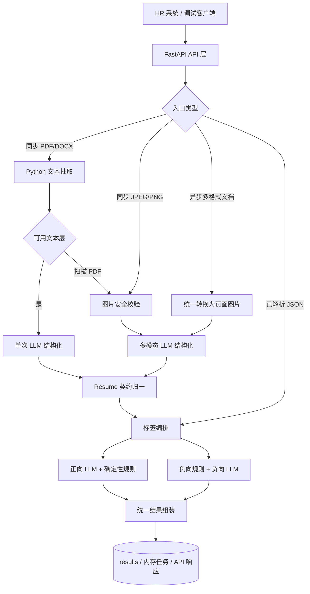
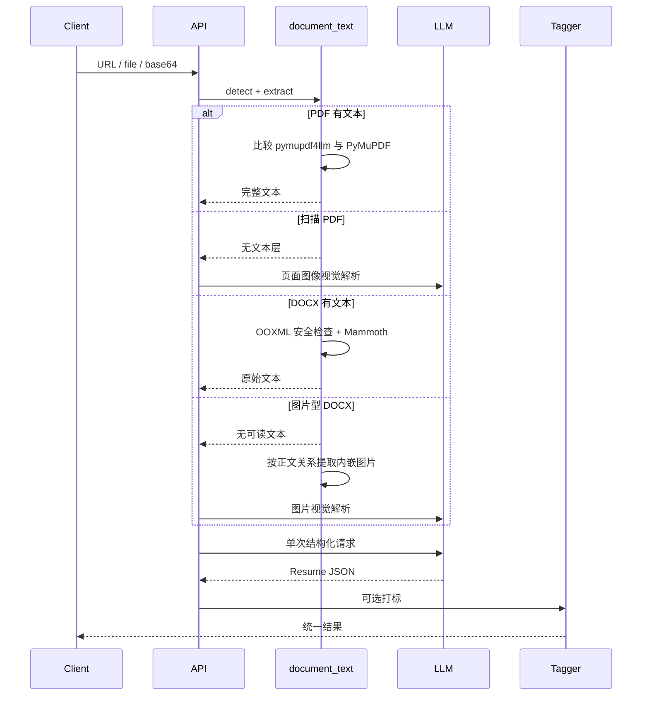
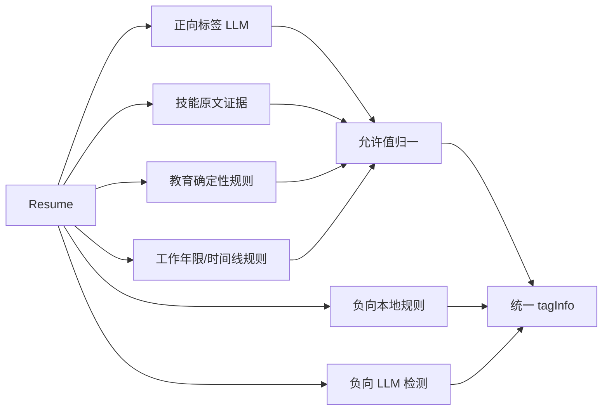
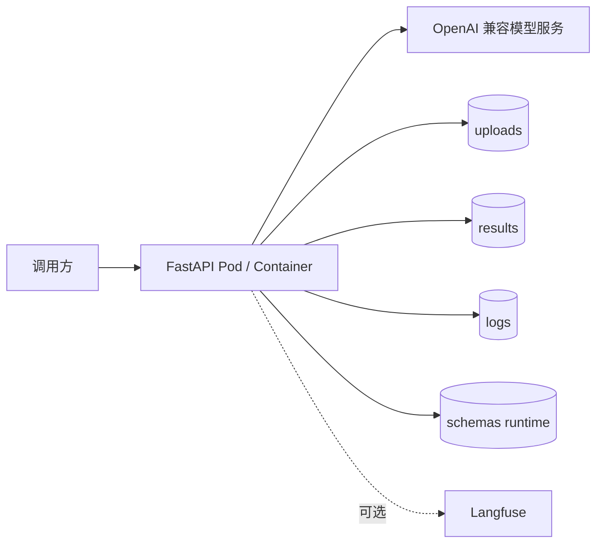

# AI 简历解析与智能打标服务概要设计

## 文档信息

| 项目 | 内容 |
| ---- | ---- |
| 项目名称 | AIHR-OneArchive / AI-Resume-ParserTag |
| 文档名称 | 系统概要设计文档 |
| 文档版本 | v1.3 |
| 更新日期 | 2026-08-07 |
| 适用对象 | 架构、开发、测试、运维、接口调用方 |
| 文档用途 | 说明系统定位、总体架构、模块分层、核心流程、数据存储、并发设计、部署视图和演进方向 |

### 修订记录

| 版本 | 日期 | 说明 | 作者 |
| ---- | ---- | ---- | ---- |
| v1.0 | 2026-07-07 | 形成总体架构、模块分层、核心业务流程、数据存储和部署视图初版 | ziyi.yao |
| v1.1 | 2026-08-04 | 依据当前代码、配置、Schema、测试和部署文件完成核查，并迁入正式 `docs/` 目录 | AIHR 项目组 |
| v1.2 | 2026-08-04 | 统一文档信息、修订记录、目录、章节编号和正文分隔格式 | AIHR 项目组 |
| v1.3 | 2026-08-07 | 同步版本化标签 ID、来源语义、工作年限与实习排除规则 | AIHR 项目组 |

---

## 目录

- [1. 系统定位](#1-系统定位)
- [2. 总体架构](#2-总体架构)
- [3. 模块分层](#3-模块分层)
- [4. 核心流程](#4-核心流程)
- [5. 数据与存储](#5-数据与存储)
- [6. 并发设计](#6-并发设计)
- [7. 部署视图](#7-部署视图)
- [8. 设计约束与风险](#8-设计约束与风险)
- [9. 演进方向](#9-演进方向)

---

## 1. 系统定位

AI-Resume-ParserTag 是一个无数据库的 FastAPI 服务。它接收 PDF、DOCX、JPEG、PNG 或已解析 Resume JSON，调用 OpenAI 兼容模型进行结构化解析和标签提取，并用本地规则、配置和 Schema 约束最终结果。

系统边界包括：

- 外部模型服务：由 `MODEL_SERVICE_URL` 和 `API_KEY` 配置。
- 本地文件系统：保存下载文件、上传文件、结果、日志和运行时标签配置。
- 可选 Langfuse：记录模型调用与业务 trace。
- 调用方：负责认证接入、任务轮询、结果持久化和人工复核。

---

## 2. 总体架构

---

## 3. 模块分层

| 层级 | 核心文件 | 职责 |
|---|---|---|
| 应用层 | `app.py` | 生命周期、CORS、路由挂载、健康检查、模型列表 |
| API 层 | `api/routes_*.py`、`api/schemas.py` | 参数校验、输入接入、任务创建、同步编排、配置管理 |
| 输入抽取 | `core/document_text.py` | PDF/DOCX/图片类型识别、安全校验、文本抽取与质量选择 |
| 解析层 | `core/parser.py` | 模型回退、文本解析、视觉解析、多页面视觉分批合并 |
| 契约层 | `core/resume_contract.py`、`core/postprocess.py` | Pydantic 校验、字段归一、最终响应组装 |
| 任务层 | `core/tasks.py` | 线程池、信号量、内存任务状态、TTL 清理、结果保存 |
| Prompt 层 | `core/prompting/` | 解析、正向标签、负向标签和标签映射 Prompt |
| 标签层 | `tag/` | 标签提取、年限/教育规则、技能库、配置结构保护、ID 映射 |
| 基础设施 | `config.py`、`logger/`、`schemas/` | 环境配置、日志、Langfuse、Schema 和运行时配置 |

---

## 4. 核心流程

### 4.1 同步文档和图片

DOCX 无文本时尝试提取正文引用的 PNG/JPEG 等 Pillow 可识别图片并进入视觉
降级；没有有效图片时明确失败。同步文本超过字符预算时仍直接失败。

### 4.2 异步多格式视觉解析

1. API 校验 PDF/DOCX/JPG/JPEG/PNG 后缀、真实内容、类型一致性、大小和批量数量。
2. 创建 `TaskRecord(status=0)` 并存入 `_task_store`。
3. 后台任务将状态更新为 `1`：PDF 渲染页面，DOCX 经 Mammoth+PyMuPDF 排版为
   A4 页面，JPEG/PNG 安全解码；最终都只把图片提交给多模态模型。
4. 完整链路进入标签阶段时更新为 `2`。
5. 成功写入 `status=3` 和结果；异常写入 `status=4` 和错误信息。
6. 清理协程每 60 秒按创建时间删除超过 `TASK_TTL_MINUTES` 的记录。

### 4.3 标签处理

版本化标签映射为每个维度和允许值维护稳定 ID。公共 JSON 返回
`mappingVersion/dimensionId/tagId` 和文本快照；后端以 ID 关联、以文本展示，不能按数组位置绑定。

---

## 5. 数据与存储

| 数据 | 存储位置 | 生命周期 |
|---|---|---|
| 异步任务 | 进程内 `_task_store` | 默认 120 分钟，按创建时间清理；重启即丢失 |
| 上传/下载文件 | `uploads/` | 部分流程结束后清理，异常残留需运维处理 |
| 完整结果 | `results/` | 当前没有内建 TTL，需要外部清理 |
| 日志 | `logs/` | 由日志配置滚动，可能包含简历 PII |
| 运行时标签配置 | `schemas/tag_config_runtime.json` | 原子替换；Docker 建议挂载 `schemas/` |
| 标签参考数据 | 版本化院校名单、公司资质、技能 ID 映射和行业证据规则 | 随代码版本发布并做契约校验 |

标签 ID 唯一事实源是 `schemas/tag_value_id_mapping.json`；当前启用状态、允许值、
负向规则和扣分以 `schemas/tag_config_runtime.json` 为准。旧 `tag_taxonomy_v1*`
不在运行链中，也不再是当前设计源。

---

## 6. 并发设计

- 全局 `ThreadPoolExecutor(max_workers=MAX_WORKERS)` 承载阻塞解析和打标。
- `_parse_semaphore` 限制同时进入解析阶段的任务数。
- 同步批量接口将请求并发限制为 1~30。
- 多页面视觉解析会按页批次创建局部线程池；这会放大全局线程和内存压力。
- 视觉渲染当前会将页面图像集合载入内存，容器资源配置必须通过压测确定。

---

## 7. 部署视图

当前部署只能安全使用单副本：任务存储是进程内存，多个副本之间不共享任务状态、幂等键或结果索引。

---

## 8. 设计约束与风险

| 约束 | 影响 |
|---|---|
| `/health` 仅检查进程存活 | 不能表示模型或存储已就绪 |
| 任务和主要解析接口无统一鉴权 | 必须由网关或服务本身补充认证与授权 |
| `type=url` 未限制目标网络 | 存在 SSRF 风险 |
| `type=file` 可读服务器路径 | 必须限制为可信调用或固定根目录 |
| CORS 允许所有来源且允许凭证 | 生产环境需要显式来源白名单 |
| 完整结果写日志和磁盘 | 需要 PII 脱敏、访问控制和数据清理 |
| 依赖模型 JSON 输出 | 仍需回归集、Schema 校验和部分成功语义 |

---

## 9. 演进方向

1. 使用 Redis/数据库保存任务、幂等键和终态结果，引入有界任务队列。
2. 增加认证、租户隔离、SSRF 防护、限流和 PII 生命周期管理。
3. 将 PDF 质量检测升级为页级策略，仅对异常页视觉降级。
4. 持续校准 DOCX 的 Mammoth HTML 页面排版，并评估使用 OOXML 结构信息改善复杂表格、页眉页脚和浮动对象还原。
5. 建立真实简历黄金数据集，持续度量字段准确率、文本完整率和标签一致性。
