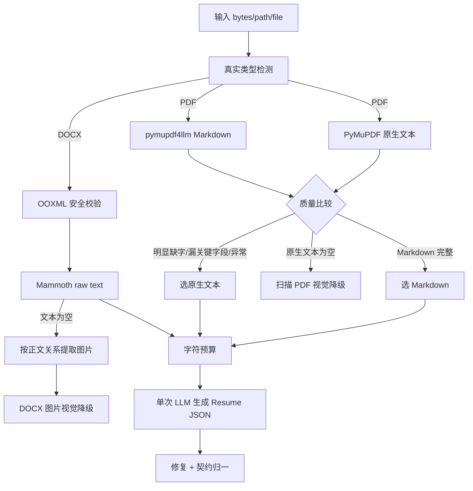

# AI 简历解析与智能打标服务详细设计

## 文档信息

| 项目 | 内容 |
| ---- | ---- |
| 项目名称 | AIHR-OneArchive / AI-Resume-ParserTag |
| 文档名称 | 系统详细设计文档 |
| 文档版本 | v1.4 |
| 更新日期 | 2026-08-07 |
| 适用对象 | 架构、开发、测试、运维、维护人员 |
| 文档用途 | 说明代码结构、文档解析、模型回退、数据契约、标签体系、异步任务、日志、错误处理和扩展约束 |

### 修订记录

| 版本 | 日期 | 说明 | 作者 |
| ---- | ---- | ---- | ---- |
| v1.0 | 2026-07-07 | 形成模块职责、函数链路、解析打标流程、异步任务和配置热更新详细设计初版 | ziyi.yao |
| v1.1 | 2026-08-04 | 依据当前代码、配置、Schema、测试和部署文件完成核查，并迁入正式 `docs/` 目录 | AIHR 项目组 |
| v1.2 | 2026-08-04 | 统一文档信息、修订记录、目录、章节编号和正文分隔格式 | AIHR 项目组 |
| v1.3 | 2026-08-07 | 同步 Resume 当前任职归一、工作年限、负向排除和标签 ID 输出 | AIHR 项目组 |
| v1.4 | 2026-08-07 | 补充异步 PDF/DOCX/JPG/JPEG/PNG 转图片视觉解析的分派、渲染和安全边界 | AIHR 项目组 |

---

## 目录

- [1. 代码结构](#1-代码结构)
- [2. 应用生命周期](#2-应用生命周期)
- [3. 配置设计](#3-配置设计)
- [4. 文档输入与安全校验](#4-文档输入与安全校验)
- [5. 文本优先解析](#5-文本优先解析)
- [6. 多格式视觉解析](#6-多格式视觉解析)
- [7. 模型调用与回退](#7-模型调用与回退)
- [8. Resume 数据契约](#8-resume-数据契约)
- [9. 标签详细设计](#9-标签详细设计)
- [10. 标签 ID 和体系边界](#10-标签-id-和体系边界)
- [11. 配置结构保护](#11-配置结构保护)
- [12. 最终结果组装](#12-最终结果组装)
- [13. 异步任务设计](#13-异步任务设计)
- [14. 日志与可观测性](#14-日志与可观测性)
- [15. 错误处理](#15-错误处理)
- [16. 已知技术债](#16-已知技术债)
- [17. 扩展规则](#17-扩展规则)

---

## 1. 代码结构

```text
app.py
config.py
api/
├── schemas.py
├── routes_async.py
├── routes_openai.py
├── routes_tags.py
└── routes_algorithm.py
core/
├── document_text.py
├── parser.py
├── postprocess.py
├── resume_contract.py
├── tasks.py
└── prompting/
logger/
├── logger_manager.py
├── operation.py
└── langfuse_client.py
tag/
├── tagger.py
├── tag_config.py
├── tag_config_guard.py
├── tag_data.py
├── reference_data.py
├── skill_library.py
└── tag_value_id_mapper.py
schemas/
├── education_institution_data.json
├── company_qualification_data.json
├── resume_result_template.json
├── tag_config_runtime.json
└── tag_value_id_mapping.json
```

---

## 2. 应用生命周期

`app.py` 创建 FastAPI `3.1.0` 实例并挂载异步、同步/OpenAI、标签配置和算法调试路由。

启动阶段：

1. `config.py` 加载 `.env` 和环境变量，缺少模型地址或 API Key 时立即失败。
2. 初始化日志管理器和可选 Langfuse。
3. 创建任务 TTL 清理协程。
4. 输出模型和运行配置摘要。

关闭阶段取消清理协程，并停止日志配置 watcher 和 queue listener。

HTTP 中间件在每个请求前重置线程本地日志上下文，防止前一请求的 requestId、业务类型和文件名泄漏到下一请求。

---

## 3. 配置设计

配置集中在 `config.py`，其他模块不直接读取环境变量。模型名使用 `ContextVar` 保存当前任务值，保证异步协程和线程池任务可以选择不同模型。

主要配置组：

| 组 | 配置 |
|---|---|
| 模型 | URL、API Key、主/异步/同步/备用模型 |
| 推理 | temperature、max tokens、timeout、retry |
| 视觉 | 144 DPI、8 张页面图片单次视觉阈值 |
| 任务 | 最大线程、TTL、文件大小、目录 |
| 文本 | 同步文档最大字符数 |
| 管理 | 标签写接口 Token |

`get_thinking_disable_params()` 按模型名前缀生成兼容参数：Qwen 使用 `enable_thinking=false`，其他模型使用 `thinking=false`。若模型返回 thinking block 签名错误，单模型调用会移除 `extra_body` 再重试一次。

---

## 4. 文档输入与安全校验

### 4.1 来源处理

`utils/file_utils.py` 接收：

- `url`：通过 `requests.get` 下载到 `UPLOAD_DIR`。
- `file`：返回服务器本地路径。
- `base64`：解码为内存字节。

文件名经过 URL 解码和 basename 规范化，用于日志和结果展示。当前 URL 保存路径直接使用调用方文件名，并发同名下载可能覆盖；URL 目标和本地路径也尚未建立生产安全边界。

### 4.2 真实类型检测

`detect_document_type()` 读取来源字节并根据魔数识别：

- `%PDF`：PDF。
- `PK` 且包含必要 OOXML 条目：DOCX。
- JPEG/PNG 魔数且 Pillow 可完整解码：独立简历图片。
- 其他内容：拒绝。

扩展名只允许 `.pdf`、`.docx`、`.jpg`、`.jpeg`、`.png`，且必须与真实内容一致。

### 4.3 DOCX 防护

交给 Mammoth 前执行：

| 检查 | 上限/规则 |
|---|---|
| ZIP 条目数量 | 5000 |
| 总解压大小 | 100 MiB |
| 单条目大小 | 30 MiB |
| 压缩比 | 200 |
| 路径 | 拒绝绝对路径和 `..` |
| 加密 | 拒绝加密条目 |
| 必需条目 | `[Content_Types].xml`、`word/document.xml` |

Mammoth 没有抽取到文本时，`extract_docx_images()` 继续读取
`word/_rels/document.xml.rels`，只接受正文按顺序引用的 `word/media/*` 图片。
视觉降级最多处理 20 张图片和 8000 万总像素；小于 32 像素的装饰图片会跳过。

异步视觉链不抽取 DOCX 文本给模型。`render_docx_pages()` 在完成同一套 OOXML
安全校验后，用 Mammoth 将正文和内嵌图片转换为 HTML，再由 PyMuPDF Story 排版为
A4 页面图片；没有可排版 HTML 时才回退到正文内嵌图片。最多渲染 20 页、累计
8000 万像素。Mammoth 在这里是本地排版适配器，模型输入仍然只有图片。

### 4.4 独立图片防护

JPEG/PNG 独立简历在模型调用前由 Pillow 完整解码，要求最短边不少于 64 像素、
总像素不超过 4000 万，并拒绝图片格式与扩展名不一致的伪装文件。独立图片及全部
异步多格式视觉解析都没有 Python 文本证据，解析和技能校验以视觉模型生成的
Resume JSON 为依据。

---

## 5. 文本优先解析

入口：`parse_sync_resume_document()`。



### 5.1 PDF 质量选择

`extract_pdf_markdown()` 同时生成 Markdown 和按阅读顺序排序的原生文本。切换到原生文本的条件包括：

- `pymupdf4llm` 不可用或抛错。
- 原生有效字符比 Markdown 多至少 500，且达到两倍。
- Markdown 漏掉姓名、电话、邮箱、学校或核心章节标记，并达到长度比阈值。

若原生文本有效字符为 0，返回 `extractor=none`，由同步上层对 PDF 页面触发视觉降级。
DOCX 的 Mammoth 文本为空时由同一上层调用独立的正文图片提取器。

该比较是文档级而不是页级。Markdown 和原生文本都可能以不同方式漏页，仍需真实样本评测。

### 5.2 文本预算

抽取文本为空时抛出 `DocumentTextUnavailableError`；超过 `SYNC_DOCUMENT_MAX_TEXT_CHARS` 时抛出 `DocumentExtractionError`。当前不会截断或分片，因为设计要求一次 LLM 统一生成完整 JSON。

### 5.3 内部技能证据

同步解析加打标入口调用 `parse_sync_resume_document(include_skill_evidence=True)`，返回 `ParsedResumeDocument`：

- `resume`：公共结构化简历。
- `skill_evidence_text`：抽取原文，仅供技能证据校验。

原文证据不会进入公共响应。同步扫描 PDF 视觉降级以及全部异步多格式视觉链都没有
独立 Python 文本证据，字段为空。

---

## 6. 多格式视觉解析

异步统一入口是 `parse_async_visual_resume_with_logging()`。它先调用
`detect_document_type()` 识别真实类型，再按类型分派：

| 类型 | 转图片函数 | 视觉解析函数 | 本地渲染器 |
|---|---|---|---|
| PDF | `pdf_to_images()` | `parse_pdf_with_visual_llm()` | PyMuPDF |
| DOCX | `render_docx_pages()` | `parse_docx_images_with_visual_llm()` | Mammoth HTML + PyMuPDF Story |
| JPEG/PNG | `extract_standalone_image()` | `parse_image_with_visual_llm()` | Pillow |

三条分支最终都进入 `_parse_visual_images_with_llm()`。异步链不会调用
`extract_document_text()`、`extract_pdf_markdown()` 或 `pymupdf4llm`，也不会把
Mammoth 生成的文本作为模型文本消息发送。

### 6.1 单批视觉解析

页面图片不超过 8 张时：

1. PDF/DOCX 页面或独立图片按阅读顺序形成 PIL RGB 图像列表。
2. 图像转为 Base64 `image_url`；多页输入在每张图像前标注页码。
3. 单次调用解析 Prompt，模型消息中只包含页码提示、图片和 JSON 输出指令。
4. 使用 `json_repair` 修复返回 JSON。
5. 后处理并通过 Resume 契约归一。

### 6.2 多页面分批

页面图片超过 8 张时：

1. `smart_batch_size()` 决定页面批次并保持原始顺序。
2. 创建局部 `ThreadPoolExecutor` 并发调用每批模型。
3. `_merge_results()` 合并 candidate、教育、工作和项目。
4. 去重、后处理并校验契约。

单批模型失败或 JSON 为空时返回 `{}`，其他批次仍继续。这会产生静默部分成功，
当前响应没有 `partial_success` 或失败页码，需要由后续版本修复。该风险适用于
PDF 页面、DOCX 渲染页和未来任何多图片输入，不只适用于长 PDF。

---

## 7. 模型调用与回退

统一入口 `_call_llm_with_fallback()` 的候选顺序为当前 `ContextVar` 模型，然后依次追加 `FALLBACK_MODELS`。

| 错误 | 行为 |
|---|---|
| 超时 | 尝试下一备用模型 |
| 404/429/5xx 等状态错误 | 记录原因并尝试下一模型 |
| 网络整体不可达 | 立即终止，不遍历同一服务地址下的模型 |
| 401/403 | 立即终止，提示检查 API Key/权限 |
| thinking 签名问题 | 同一模型去掉 thinking 参数重试一次 |

当前备用模型共享同一个 `MODEL_SERVICE_URL`，不能解决整个服务地址不可达问题。

---

## 8. Resume 数据契约

`ResumeData` 是解析、仅打标和 API Schema 共用契约。

### 8.1 字段

| 对象 | 字段 |
|---|---|
| candidate | name、phone、email、gender、age、address、nativePlace、selfEvaluation、expectedSalary、expectedPosition |
| education | school、major、degree、education、startDate、endDate |
| work | company、position、description、startDate、endDate |
| project | company、projectName、role、description、startDate、endDate |

### 8.2 归一规则

- 未知字段忽略。
- `candidate=null` 归一为空对象；非对象拒绝。
- `educations/works/projects=null` 归一为空数组；非数组拒绝。
- age、gender 无法转换时为 0。
- 其他简单标量转为去空白字符串；空值为 `""`。
- `目前/现在/在职/current/present/now` 统一为 `至今`。
- 原文未提供工作结束日期时保持为空，不根据开始时间或经历顺序推断为“至今”。
- 公开 Schema 不包含 `employmentType`，未知额外字段会被忽略。

`_post_process()` 还会修正性别、年龄和旧模型字段，`_validate_schema()` 依据结果模板补全结构，最终再调用 `normalize_resume_payload()`。

---

## 9. 标签详细设计

### 9.1 配置加载

`tagger._tagger_load_cfg()` 和输出组装优先读取 `schemas/tag_config_runtime.json`，不存在时回退到 `tag/tag_config.py`。配置读取使用 mtime 缓存，使新任务感知热更新。

### 9.2 正向标签

`run_tagging()` 调用正向 LLM 提取，并经过以下确定性步骤：

1. `_canonicalize_values()` 将模型值归一到允许值。
2. `classify_education()` 根据学校和学历计算教育标签，覆盖模型冲突。
3. `calculate_work_experience()` 合并重叠的正式工作月份，单独处理实习并映射年限段。
4. `_collect_skill_evidence_text()` 汇总结构化 Resume 和内部原文证据。
5. `_extract_skills_rule()` 从证据召回标准技能，过滤短词、宽泛歧义别名和否定、
   学习计划、岗位要求、优先条件等非能力语境。
6. `_prepare_positive_prompt_dimensions()` 深拷贝维度配置，只把证据候选注入技能
   Prompt；完整 300 项配置继续用于模型结果校验。
7. 候选为空时，技能 Prompt 和 Schema 示例均要求输出空数组；模型漏提时规则补齐。
8. 技能最终截断到 12 个。
9. `sort_positive_tag_entries()` 固定五个维度顺序。
10. `classify_education()` 使用版本化院校事实源，国内名单数量和集合关系在加载时
    校验；双一流独立于 211 匹配。
11. `classify_companies()` 使用公司资质快照并允许一家公司输出多个背景；无论 LLM
    是否成功都补充已验证资质，并拒绝未通过事实源或明确证据复核的模型值；未知
    公司只接受非客户语境的明确资质证据。
12. `classify_industry()` 对 LLM 值和规则降级值执行同一强证据校验；辅助词不独立
    触发，排除表达降低规则分数，按证据强度最多输出 3 个行业。
13. `companyBg` 和 `industry` 各维护 16 个标准值；旧名称仅作为 ID 映射别名，
    不再作为新响应标准值。

技能 Prompt 压缩日志只包含技能库总数、候选数、省略数和 Prompt 字符数。四候选
回归样例从 54,444 字符降到 6,668 字符，压缩 87.75%，内部原文正文不会进入日志。

技能中的“不熟悉”“未使用”“仅了解”“计划学习”、岗位要求和仅出现在主修课程
区段中的词均不构成有效证据；存在另一处独立使用证据时才保留。教育和工作年限
不带 confidence；其他维度使用模型维度置信度、整体置信度或规则证据分值。

### 9.3 工作年限

工作年限规则考虑：

- 年/月日期精度。
- `至今` 和当前日期。
- 正式工作区间重叠合并。
- 实习/兼职等非全职经历不并入正式年限。
- 应届、往届无经验属于同一工作年限维度中的身份兜底值；只有存在有效正式区间
  时才进入数值档位。
- 数值档位采用左闭右开：`1年以下 [0,12)`、`1-3年（满1年） [12,36)`、
  `3-5年（满3年） [36,60)`、`5-10年（满5年） [60,120)`、
  `10年及以上 [120,+∞)`。
- 实习/兼职通过职位和描述关键词识别，不并入正式年限。

### 9.4 负向标签

负向风险包括：

- 本地关键词规则 `_detect_keyword_rules()`。
- 职业稳定性 `_detect_stability()`。
- 时间线重叠 `_detect_timeline_overlap()`。
- 岗位敏感词 `_detect_custom_words()`。
- 教育/培训背景 `_detect_education_risk()`。
- 配置为 LLM 类型的语义风险 `extract_negative_tags_llm()`。

每条命中包含标签、severity、matchedContent，扣分来自 `severityDeduction`。
职业稳定性和时间线重叠检测都先排除实习、兼职等非正式经历；当前识别依赖
`position/description` 关键词，缺少明确类型文本时仍可能误判。

---

## 10. 标签 ID 和体系边界

`schemas/tag_value_id_mapping.json` 维护五个正向和四个负向稳定维度 ID：

```text
1001 education   教育背景
1002 companyBg   公司背景
1003 workYears   工作年限
1004 skills      技能标签
1005 industry    行业背景
2001 jobstable   职业稳定性风险
2002 integrity   诚信与合规风险
2003 matchRisk   匹配度硬伤
2004 location    地域相关
```

再为每个正向允许值维护 8 位标签 ID：

```json
{
  "id": "10010001",
  "dimension": "education",
  "value": "C9",
  "aliases": ["C9联盟"]
}
```

`TagValueIdMapper` 校验：

- ID 为 8 位数字且全局唯一。
- 维度 ID 为 4 位数字且维度代码、展示名唯一。
- 标签 ID 的前四位必须等于所属维度 ID，例如 `10040001` 属于 `1004/skills`。
- 维度内标准值唯一。
- 负向规则通过 `dimension + ruleKey` 解析稳定标签 ID，例如
  `location/sensitive_words -> 20040001/敏感地域`。
- 标准值和唯一别名可确定性解析。
- 多个标签共享的歧义别名进入 ambiguous 集合，解析返回 `None`。

`TagConfigStructureGuard` 要求所有运行时 `allowedValues` 都能解析到独立 ID。`_conform_to_template()` 同时输出 `mappingVersion`、`dimensionId`、`tagId` 和业务文本；无法映射的非白名单标签不会进入公共结果。`GET /api/tags/mapping` 提供当前完整映射快照，配置接口返回同一版本号。

标签值和 ID 的唯一事实源为 `tag_value_id_mapping.json`，运行时允许值和维度结构以 `tag_config_runtime.json` 为准。项目不再维护独立的标签本体文件，避免同一标签在多套配置中产生冲突。

---

## 11. 配置结构保护

`validate_runtime_tag_config()` 在写盘前检查：

- 顶层只允许 `positiveDimensions`、`negativeDimensions`、`severityDeduction`。
- 正负维度集合、顺序和 dimension 不可改变。
- 正向维度字段集合不可改变；允许值必须是非空、唯一字符串。
- 负向维度和规则的嵌套结构不可改变。
- severity 只允许 low/medium/high，值必须为 0 或负整数。
- 每个正向允许值必须有独立 ID 映射。

路由层因此直接拒绝所有新增/删除操作。允许更新的配置先写 `.tmp` 再原子替换；Docker Desktop 单文件挂载导致 replace 失败时回退为锁保护的 copy + unlink。

---

## 12. 最终结果组装

`_conform_to_template()`：

1. 每次读取最新运行时配置。
2. 裁剪 Resume 为公开字段。
3. 过滤已禁用维度和非允许值。
4. 再次限制技能数量。
5. 再次用确定性教育规则覆盖教育标签。
6. 按固定顺序输出正向维度。
7. 将内部风险分组转换为 `negativeTags.tagsArray`。

公共结果结构参见接口文档第 9 节。`source` 只允许 `rule`、`llm`、`hybrid`：教育和工作年限为纯规则，公司、技能和行业在模型候选通过规则复核时为混合来源，当前内置负向标签为纯规则。

---

## 13. 异步任务设计

### 13.1 数据结构

`TaskRecord` 主要字段：

| 字段 | 说明 |
|---|---|
| `task_id` | UUID |
| `status` | 0~4 状态 |
| `created_at`、`completed_at` | 创建/完成时间戳 |
| `estimated_seconds` | 展示用估算时间 |
| `result` | 完整结果或仅解析结果 |
| `error_msg` | 失败原因 |
| `extra` | 调用方业务透传值 |

单文件 `requestId` 通过动态属性挂载，不在 dataclass 正式字段中。

### 13.2 并发组件

| 组件 | 作用 |
|---|---|
| `_task_store` | 当前进程任务字典 |
| `_task_lock` | 保护任务读写 |
| `_cfg_lock` | 保护运行时标签配置 |
| `executor` | 全局阻塞线程池 |
| `_parse_semaphore` | 限制同时进入解析阶段的任务数 |

`wrap_for_executor()` 使用 `copy_context()` 将日志和模型 `ContextVar` 传播到工作线程。

### 13.3 TTL

`_periodic_cleanup()` 每 60 秒执行一次，删除 `created_at < now - TTL` 的任务。它不区分运行中或终态，也不按 `completed_at` 计算。

### 13.4 流水线

`run_parse_and_tag_task()`：默认调用 `parse_async_visual_resume_with_logging()`，执行多格式
文档转图片视觉解析 → 打标 → 模板组装 → 日志 → 保存结果 → 更新任务终态。同步组合接口显式
传入 `parse_sync_resume_for_tagging_with_logging()`，不会使用该默认解析器。

`run_async_parse_task()`：多格式文档转图片视觉解析 → 生成可供仅打标接口复用的对象；不调用
`extract_document_text()` 或 `extract_pdf_markdown()`。

`run_async_tag_task()`：Resume 打标 → 模板组装 → 保存结果。

---

## 14. 日志与可观测性

`logger/operation.py` 提供同步 context manager、异步装饰器、完成信息 JSON 和完整
响应 JSON 输出，统一记录开始、结束、耗时和失败字段。`logger_manager.py` 提供：

- 请求、业务、文件和额外 ContextVar。
- 文本/JSON formatter。
- 按时间和大小滚动文件。
- 配置 watcher 和异步日志队列。
- 第三方噪声过滤。

文本日志表头固定为：

```text
YYYY-MM-DD HH:mm:ss | LEVEL | [中文业务类型] [文件名] | [文件.py:行号 方法名] | 消息
```

表头不显示 `trace/task`。控制台日期为蓝色，DEBUG/INFO/WARNING/ERROR 分别为
青/绿/黄/红色；文件 handler 使用无 ANSI 的相同字段格式。HTTP 中间件统一捕获
JSON 响应，排除 `/health` 和 `/openapi.json`，先输出接口完成信息 JSON，再输出与
响应体一致的完整 JSON。异步轮询中间状态使用 DEBUG，终态使用 INFO；非零业务码
和 HTTP 4xx 使用 WARNING，HTTP 5xx 使用 ERROR。

Langfuse 使用 taskId 作为 session_id、文件名作为 user_id，并记录模型和业务阶段。未配置密钥时装饰器退化为空操作。

完整简历 API 响应会按行写入日志，结果也会写入 `results/`。这是当前明确的排障
需求，但会扩大 PII 暴露面；生产必须配置授权日志域、访问审计、加密、采集隔离和
保留期限。若后续实施最小化 PII，应把完整响应迁移到独立受控审计日志，并保留接口
完成摘要，而不能让普通日志平台无边界采集。

---

## 15. 错误处理

| 层级 | 行为 |
|---|---|
| Pydantic | 无效请求返回 HTTP 422 |
| 文档抽取 | 类型、安全、加密、预算错误向上抛出 |
| 模型 | 按错误类型决定回退或终止 |
| JSON | 使用 `json_repair` 后继续执行契约校验 |
| 异步任务 | 所有异常转换为 `status=4` |
| 同步批量 | 单项异常隔离为失败项 |
| 标签配置 | 结构错误返回 400/1005，结构变更返回 409/1003 |

当前多数业务错误仍使用 HTTP 200 + 非零业务码，OpenAI 和标签路由又使用 HTTP 4xx，调用方必须兼容两层错误判断。

---

## 16. 已知技术债

1. URL 下载缺少 SSRF 防护，同名文件存在覆盖竞争。
2. `type=file` 缺少允许根目录约束。
3. 任务存储、幂等和结果索引不能跨进程。
4. 提交没有有界队列，线程池和多页面视觉解析局部线程池可能叠加。
5. 多页面视觉解析单批失败被合并为空，缺少部分成功语义。
6. PDF 完整度判断是文档级，DOCX raw text 会损失部分结构边界。
7. 运行时配置、标签 ID 映射、技能库和参考数据是多份协作契约，需要持续做一致性测试；旧 taxonomy 已退出运行链。
8. CORS、认证、PII 日志和磁盘保留策略未达到生产安全要求。
9. `/health` 只提供 liveness，缺少 readiness。
10. API 路由、错误文案和文档仍需通过 OpenAPI 快照测试持续防漂移。

---

## 17. 扩展规则

### 17.1 新增文档格式

必须同时修改真实类型检测、抽取器、安全预算、API 能力矩阵、Resume 回归测试和部署依赖。不能只在 `ALLOWED_EXTENSIONS` 增加后缀。

### 17.2 修改标签允许值

必须同时：

1. 更新代码/运行时允许值来源。
2. 为每个值维护唯一 ID 和别名。
3. 同步技能库或分类数据。
4. 运行 `test_tag_mapping_and_config.py` 和 Prompt 覆盖测试。

院校和公司资质内容不写入运行时标签配置：分别修改
`education_institution_data.json` 和 `company_qualification_data.json`，升级版本和
来源，并运行 `test_reference_data.py`。行业规则修改必须同时增加正例和误判反例。

### 17.3 修改公共结果

公共结果变更必须同时更新 Pydantic 响应模型、结果模板、OpenAPI、映射版本和契约测试。当前公共结果已包含 `mappingVersion/dimensionId/tagId`；后续 ID 或含义变化必须升级映射版本，不得原地复用旧 ID。

### 17.4 修改并发或任务存储

需要同时验证路由轮询、幂等、任务 TTL、结果保存、优雅停机、负载均衡和压测指标。

### 17.5 黄金集发布门禁

真实简历和含 PII 的人工标注不进入 Git。发布候选版本固定模型、Prompt、参考数据
版本后生成匿名预测结果，执行 `scripts/evaluate_golden_set.py`。字段准确率、正向标签
F1 或负向标签 F1 低于私有清单阈值时禁止发布。
